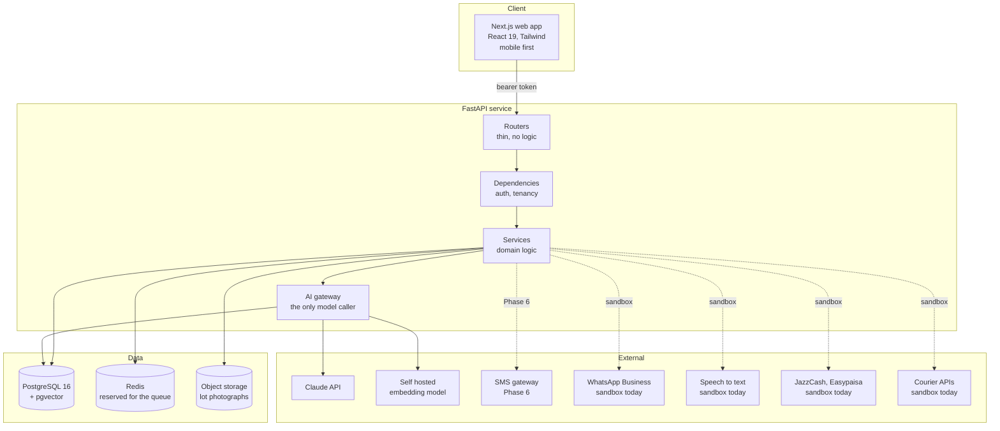
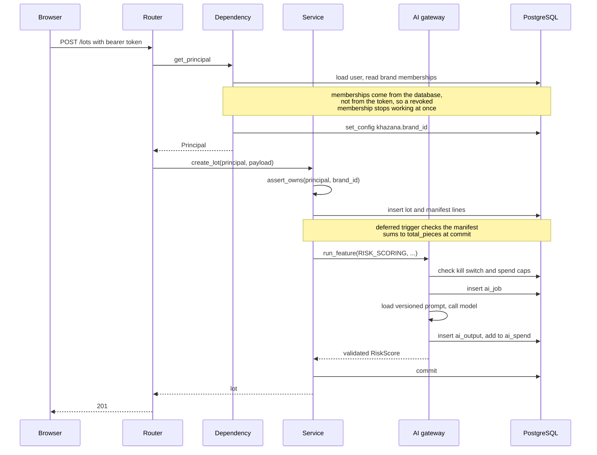
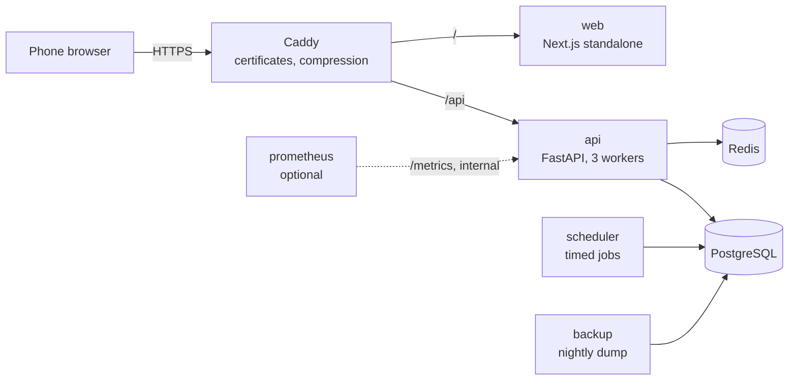

# Architecture

What exists after Phase 5, how the pieces fit, and the decisions that would be
expensive to reverse later.

## System shape



Dotted lines are integrations that exist as interfaces with sandbox
implementations, because the real ones need merchant accounts, a courier
contract, a verified WhatsApp business and a speech service, all of which
need a registered company. Production refuses every sandbox provider.

## Request lifecycle



## The four load bearing decisions

### 1. One gateway for every model call

Nothing outside `ai/gateway` constructs an Anthropic client. This buys five
things that scattered SDK calls never do: one place to change a model when a
price changes, cost attributed per feature and per brand, a kill switch per
feature, versioned prompts so a bad output can be traced to exact text, and a
single choke point for prompt injection defence.

The cost of the decision is one indirection. It is worth it.

### 2. Tenancy is explicit in the application, with the database as backstop

`core/tenancy.py` is the primary control: every query touching a brand owned
table goes through `scoped` or `assert_owns`. PostgreSQL row level security
policies exist in migration 0001 as a second line, but they only bite when the
application connects as a non owner role, and they do not exist at all on
SQLite where the tests run.

Relying on the policies alone would mean the protection is invisible in
development and untested, which is how it silently breaks.

A cross tenant read answers 404, never 403. Confirming that a record exists
but belongs to someone else is itself a leak.

### 3. Policy is data

Commission rates, discount bands, protection defaults, payout terms, lot
minimums, courier choice and per brand AI budgets are rows in
`brand_policies`. No module reads a commission constant.

This is what makes the build first order in the roadmap survivable: when a
brand negotiates different terms in Phase 6, it is an UPDATE, not a release.

One field resists configuration on purpose. `require_brand_approval` has a
CHECK constraint pinning it to true. A brand may set its own commercial terms
but may not remove its own protection.

### 4. The money path is boring

Integer rupees, never floats. Commission snapshotted onto the order. Totals
constrained by CHECK, not merely computed. Payouts require a named approver.
Escrow has an explicit `HELD` state that neither side can skip.

No model touches any of it.

## Layering, and what each layer may do

| Layer | May | May not |
| --- | --- | --- |
| Routers | Parse, call one service, map errors | Contain domain logic or raw queries |
| Dependencies | Authenticate, resolve tenancy, set session variables | Write data |
| Services | Domain logic, transactions, audit writes | Construct a model client, decide HTTP codes |
| AI gateway | Call models, price, cap, validate, record | Write business entities |
| Models | Structure, constraints, derived properties | Perform input or output |

A pull request that puts a query in a router or a commission constant in a
service is wrong even if the tests pass.

## Running in production



One server runs `docker-compose.prod.yml`. Caddy is the only service with
public ports, and serves the web app and the API from one origin so a phone
never pays for a CORS preflight ([ADR 0005](decisions/0005-api-on-the-web-origin.md)).
A `migrate` step runs before the API starts. The `scheduler` runs every timed
job on a Pakistan time timetable, straight against the database: the daily
markdown batch and its collection, pool expiry, dispute windows, the risk
review, forecasts and the AI cache purge. Staging is the same file with
staging settings. [deployment.md](deployment.md) has the procedure.

Every request gets a request id, returned as `X-Request-ID` and written into
its JSON log lines; request counts and latency by route are exported for
Prometheus; errors go to a Sentry compatible service with personal data
stripped first.

## Security posture after Phase 5

| Concern | Position today | Next step |
| --- | --- | --- |
| Authentication | Phone OTP, codes hashed and single use, attempts capped, five codes an hour per phone and twenty per network address | A second factor for admins |
| Sessions | Signed access token checked against a per user cut off, so signing out ends it at once; refresh token hashed, rotated on use, and reuse signs the user out everywhere | Move the refresh token to an httpOnly cookie |
| Token storage in the browser | sessionStorage, which page scripts can read, behind a Content Security Policy that lets the page talk only to its own origin | Same cookie change |
| Tenant isolation | Application scoping, a test that asks every brand scoped route as the wrong brand, row level policies as backstop | Buyer policies, then connect as a non owner role |
| Route authentication | Every route needs a session except a short public list, checked by a test that walks every route and by the OpenAPI contract | Keep the list short |
| Uploads | Chunked reads capped at 10 MB, type checked against the bytes, image size checked before decoding, every photo re-encoded without metadata | Malware scanning when documents are opened by staff |
| Secrets | Environment only, `.env` git ignored, private key hook, Trivy secret scan in CI | A secrets manager on the server |
| Production misconfiguration | Startup refuses the sample secret, OTP echo, offline AI, SQLite, the development database password, Redis without a password, plain HTTP, the sandbox IBAN, and no trusted proxy | Keep extending the check |
| Prompt injection | Untrusted text labelled as data, filled in values unable to impersonate the prompt, prices clamped in code, tools run as the signed in user | Adversarial cases in every eval suite |
| Dependencies | Trivy fails CI on any fixable high or critical advisory; pip-audit and npm audit clean | Automated update pull requests |
| AI cost | Caps checked before the call, kill switches, prompt caching measured, a response cache, the Batch API for the markdown run, models chosen by live evals | Re-test Haiku 5.5 on the two Haiku 4.5 routes |
| AI and money | AI chooses a price only inside a brand set band that code clamps, under ADR 0001, every move audited | Keep every new agent inside the four conditions |
| Audit | Append only approvals and audit log, enforced by trigger, with a viewer in the admin panel | Retention policy |

[security.md](security.md) lists every control with the test that proves it.

## Deliberate limitations after Phase 5

Stated so they are decisions rather than surprises.

- **Sandbox providers.** Payments, couriers, SMS, WhatsApp and speech to text
  run on sandbox implementations behind their real interfaces. Production
  refuses them, so a launch needs the real adapters first; the checklist is in
  [deployment.md](deployment.md).
- **Offline AI by default.** The tests and the CI evals read recorded replies,
  which pins the pipeline, not the model. The last live run of every suite is
  recorded in [ai-features.md](ai-features.md).
- **Visual search needs PostgreSQL and a real embedding service.** The default
  embedding provider is a local stand in that only finds identical photographs.
- **Local file storage.** Uploads live in a Docker volume until object storage
  is connected.
- **Server written sentences are English.** Forecast reasons, profit
  assumptions and similar text built by the API reach Urdu pages in English,
  shown with the right text direction. Interface copy is in all three
  languages.

## Running tests

Everything runs in containers, so none of it depends on host tooling:

```powershell
.\scripts\dev.ps1 test      # SQLite, fast, every test
.\scripts\dev.ps1 pgtest    # the PostgreSQL only tests, in a disposable database
.\scripts\dev.ps1 evals     # AI eval suites against fixtures, free
.\scripts\dev.ps1 check     # lint, format, types and tests together
```

`pgtest` is separate because those tests drop every table, so they need a
database they are allowed to destroy. The module skips itself unless
`TEST_DATABASE_URL` names a database whose name contains "test", and the
fixture checks again before touching a schema. Pointing them at the working
database deletes it, which is what the guards exist to prevent.

CI runs eight jobs, all required: the repository rules gate; API lint, types,
tests and a dependency audit; migrations applied, rolled back and applied
again on real PostgreSQL, with a backup restored and compared and the
PostgreSQL only tests; the web lint and build; the eval suites, offline so a
prompt change cannot silently break the pipeline or cost money; the money
path in a browser; the production stack started as staging and tested through
HTTPS; and a dependency and secret scan that fails on any fixable high or
critical advisory.

See [development.md](development.md) for the full command list and the
troubleshooting notes.
